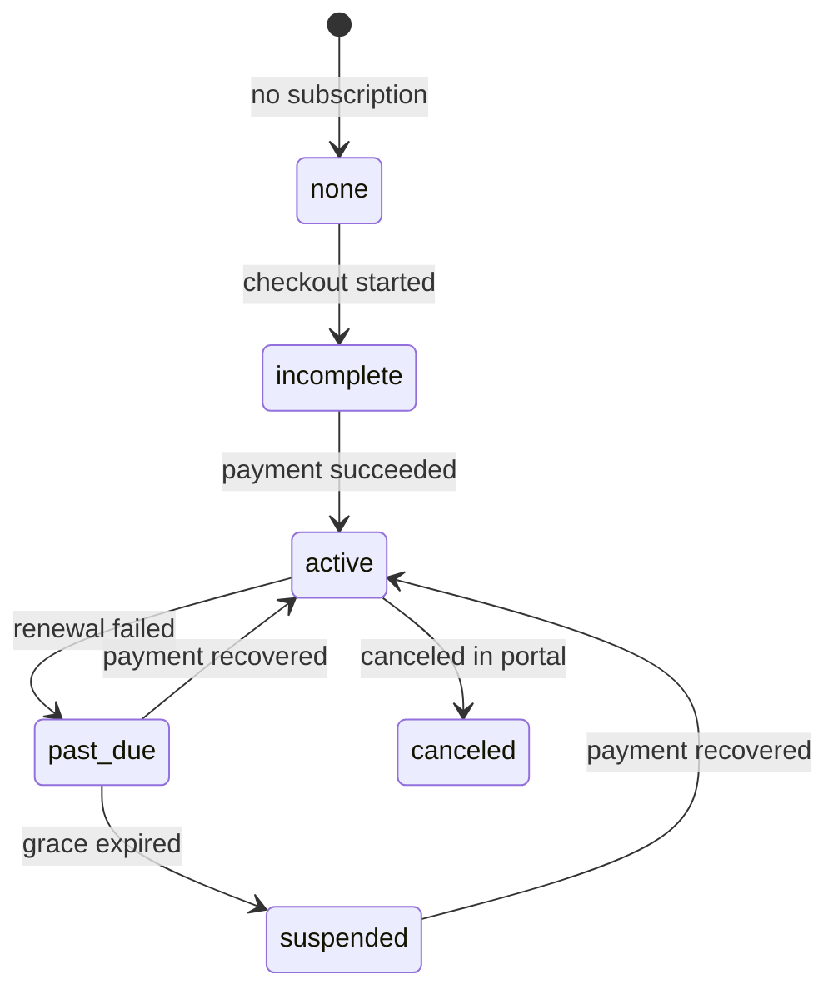

# ConsentMD Payments — API Reference

**Audience:** Frontend, `consentmd-node-backend`, and other ConsentMD integrators  
**Service:** `consentmd-payments`  
**Version:** June 2026  
**Interactive docs:** `{BASE_URL}/api/docs` (Swagger)

---

## Overview

`consentmd-payments` is the **subscription billing and entitlement service** for the ConsentMD suite.

| Responsibility | This service | Not this service |
|----------------|--------------|------------------|
| Org subscriptions (Starter / Pro / Enterprise) | Yes | — |
| Stripe Checkout, upgrades, Customer Portal | Yes | — |
| Entitlement / feature gating API | Yes | — |
| Grace period & suspension after failed payment | Yes | — |
| User login / registration | — | Laravel IdP |
| Per-consultation billing | — | Other services |
| Legacy `setup-billing` / `billing-portal` IdP proxies | — | Deprecated on node-backend |

All routes use the `/api` prefix.

---

## Base URLs

| Environment | URL |
|-------------|-----|
| Local | `http://localhost:3001` |
| Staging | *(your deployed payments host)* |
| Production | *(your deployed payments host)* |

**Suggested frontend env var:** `VITE_PAYMENTS_API_URL` or `NEXT_PUBLIC_PAYMENTS_API_URL`

---

## Authentication

| Route group | Auth | Header |
|-------------|------|--------|
| Public | None | — |
| User billing | Laravel JWT (RS256) | `Authorization: Bearer <access_token>` |
| Org admin actions | JWT + org admin in IdP | Same JWT |
| Server-to-server entitlement | Shared API key | `x-api-key: <INTERNAL_API_KEY>` |
| Stripe webhooks | Stripe signature | `stripe-signature: <sig>` |

The JWT is the same Passport token issued by Laravel (`POST /api/auth/email-login`). Payments validates it with `LARAVEL_JWT_PUBLIC_KEY`.

### Org admin requirement

These endpoints require the caller to be an **organization owner or admin** for the `organizationId` in the request:

- `POST /api/billing/checkout`
- `POST /api/billing/portal`
- `POST /api/billing/upgrade`

Returns **`403 Forbidden`** if the user is not an org admin. Platform `role: admin` in the JWT also passes.

---

## Organization identifier

`organizationId` accepts either:

| Form | Example | Notes |
|------|---------|-------|
| Numeric Laravel org id | `"1"` | Preferred |
| Tenant slug | `"consent-m-d-demo"` | Resolved via IdP internal API |

Use the numeric id when multiple orgs share a tenant slug (otherwise **`422`**).

---

## Endpoints

### `GET /api/health`

Health check. No authentication.

**Response `200`:**

```json
{
  "status": "ok",
  "service": "consentmd-payments"
}
```

---

### `GET /api/billing/plans`

List subscription tiers for pricing pages. **Public — no auth.**

**Response `200`:**

```json
[
  {
    "tier": "starter",
    "name": "Starter",
    "monthlyPriceUsd": 250,
    "minSeats": 1,
    "maxSeats": 25,
    "stripePriceId": "price_..."
  },
  {
    "tier": "pro",
    "name": "Pro",
    "monthlyPriceUsd": 450,
    "minSeats": 26,
    "maxSeats": 50,
    "stripePriceId": "price_..."
  },
  {
    "tier": "enterprise",
    "name": "Enterprise",
    "monthlyPriceUsd": 750,
    "minSeats": 51,
    "maxSeats": null,
    "stripePriceId": "price_..."
  }
]
```

---

### `POST /api/billing/checkout`

Start Stripe Checkout for a **new** subscription. **JWT + org admin.**

**Request body:**

| Field | Type | Required | Description |
|-------|------|----------|-------------|
| `organizationId` | string | yes | Numeric org id or tenant slug |
| `plan` | `"starter"` \| `"pro"` \| `"enterprise"` | yes | Must match live member count |
| `successUrl` | URL | yes | Redirect after payment; `session_id` query param appended if missing |
| `cancelUrl` | URL | yes | Redirect if user cancels |

**Example:**

```json
{
  "organizationId": "consent-m-d-demo",
  "plan": "starter",
  "successUrl": "https://app.consentmd.com/billing/success",
  "cancelUrl": "https://app.consentmd.com/billing/cancel"
}
```

**Response `201`:**

```json
{
  "checkoutUrl": "https://checkout.stripe.com/c/pay/cs_test_...",
  "sessionId": "cs_test_..."
}
```

**Errors:**

| Status | Cause |
|--------|-------|
| `401` | Missing or invalid JWT |
| `403` | Not org admin |
| `404` | Organization not found |
| `422` | Plan does not match member count |
| `422` | Org already has a Stripe subscription (use `/upgrade`) |
| `422` | Member count unavailable from IdP |

**Integrator flow:** Redirect browser to `checkoutUrl`. On return, poll `GET /api/billing/subscription` until `entitlement.active` is `true`.

---

### `GET /api/billing/subscription`

Full subscription record + computed entitlement. **JWT required.**

**Query parameters:**

| Param | Required | Description |
|-------|----------|-------------|
| `organizationId` | yes | Numeric id or tenant slug |

**Example:**

```http
GET /api/billing/subscription?organizationId=1
Authorization: Bearer <token>
```

**Response `200` (no subscription):**

```json
{
  "organizationId": "1",
  "subscription": null,
  "entitlement": {
    "active": false,
    "plan": null,
    "seatLimit": 0,
    "seatCount": 16,
    "status": "none",
    "currentPeriodEnd": null,
    "gracePeriodEnd": null,
    "suspended": false
  }
}
```

**Response `200` (active subscription):**

```json
{
  "organizationId": "1",
  "subscription": {
    "id": "4cc46c14-3df1-431f-8f41-2a1f0d3fa351",
    "organizationId": "1",
    "tenant": "consent-m-d-demo",
    "stripeCustomerId": "cus_...",
    "stripeSubscriptionId": "sub_...",
    "plan": "starter",
    "status": "active",
    "seatCount": 16,
    "seatLimit": 25,
    "currentPeriodEnd": "2026-07-22T03:28:04.000Z",
    "pastDueSince": null,
    "gracePeriodEnd": null,
    "suspendedAt": null,
    "billingEmail": "billing@consentmd-demo.com",
    "createdAt": "2026-06-11T14:58:57.377Z",
    "updatedAt": "2026-06-22T03:40:05.000Z"
  },
  "entitlement": {
    "active": true,
    "plan": "starter",
    "seatLimit": 25,
    "seatCount": 16,
    "status": "active",
    "currentPeriodEnd": "2026-07-22T03:28:04.000Z",
    "gracePeriodEnd": null,
    "suspended": false
  }
}
```

`seatCount` is refreshed from the IdP when a bearer token is present.

---

### `GET /api/billing/entitlement/:organizationId`

Lightweight entitlement for feature gating in user-facing apps. **JWT required.**

**Path parameter:** `organizationId` — numeric id or tenant slug.

**Response `200`:**

```json
{
  "active": true,
  "plan": "starter",
  "seatLimit": 25,
  "seatCount": 16,
  "status": "active",
  "currentPeriodEnd": "2026-07-22T03:28:04.000Z",
  "gracePeriodEnd": null,
  "suspended": false
}
```

#### Entitlement fields

| Field | Type | Description |
|-------|------|-------------|
| `active` | boolean | **`true`** = grant premium access. See gating rules below. |
| `plan` | string \| null | `starter`, `pro`, `enterprise`, or `null` |
| `seatLimit` | number | Max seats for current plan (reduced when suspended) |
| `seatCount` | number | Org member count (live from IdP on JWT route) |
| `status` | string | Stripe/synced status — see lifecycle table |
| `currentPeriodEnd` | ISO date \| null | End of current paid billing period |
| `gracePeriodEnd` | ISO date \| null | While `past_due`, full access until this time |
| `suspended` | boolean | `true` after grace expired — org suspended |

#### Feature gating rules

```text
if (entitlement.active) {
  // Allow premium features
} else if (entitlement.status === 'past_due' && entitlement.gracePeriodEnd) {
  // Optional: show "payment failed — update billing by {gracePeriodEnd}"
} else if (entitlement.suspended) {
  // Block access — show billing portal CTA
}
```

| `status` | `active` | Meaning |
|----------|----------|---------|
| `none` | `false` | No subscription |
| `incomplete` | `false` | Checkout started, not paid |
| `active` | `true` | Paid and current |
| `trialing` | `true` | Trial period |
| `past_due` | `true` during grace, then `false` | Renewal payment failed |
| `suspended` | `false` | Grace expired — org suspended |
| `unpaid` | `false` | Stripe exhausted retries |
| `canceled` | `false` | Subscription canceled |

**Primary gate:** `entitlement.active === true`

**Seat overflow:** When `seatCount > seatLimit`, prompt upgrade via `POST /api/billing/upgrade`.

---

### `GET /api/billing/internal/entitlement/:organizationId`

Same response shape as the JWT entitlement endpoint. **Server-to-server only.**

```http
GET /api/billing/internal/entitlement/1
x-api-key: <INTERNAL_API_KEY>
```

- No JWT required
- `seatCount` comes from the **cached DB value** (no IdP round-trip)
- Use from `consentmd-node-backend` and other backends for middleware / API guards

---

### `POST /api/billing/upgrade`

Change plan on an **existing** Stripe subscription (prorated). **JWT + org admin.**

Does **not** use Checkout — use this when the org already has `stripeSubscriptionId`.

**Request body:**

| Field | Type | Required |
|-------|------|----------|
| `organizationId` | string | yes |
| `plan` | enum | yes |

**Response `200`:**

```json
{
  "organizationId": "1",
  "plan": "pro",
  "status": "active",
  "stripeSubscriptionId": "sub_..."
}
```

**Errors:**

| Status | Cause |
|--------|-------|
| `404` | No existing Stripe subscription (use `/checkout` first) |
| `422` | Plan does not match member count |

---

### `POST /api/billing/portal`

Create a Stripe Customer Portal session (update card, view invoices, cancel). **JWT + org admin.**

**Request body:**

| Field | Type | Required |
|-------|------|----------|
| `organizationId` | string | yes |
| `returnUrl` | URL | yes |

**Response `200`:**

```json
{
  "url": "https://billing.stripe.com/p/session/..."
}
```

Redirect the user to `url`. Returns **`404`** if no Stripe customer exists.

---

## Subscription tiers

| Plan | `plan` value | Monthly (USD) | Seats |
|------|--------------|---------------|-------|
| Starter | `starter` | $250 | 1–25 |
| Pro | `pro` | $450 | 26–50 |
| Enterprise | `enterprise` | $750 | 51+ |

At checkout/upgrade, the service validates the plan against **live `member_count`** from the Laravel IdP. Mismatch returns **`422`**.

---

## Billing lifecycle (failed payment)

When a renewal payment fails:

1. **`invoice.payment_failed`** webhook → status `past_due`, grace period starts (default **7 days**)
2. During grace → **`entitlement.active` stays `true`**, `gracePeriodEnd` is set
3. Billing email sent to `billingEmail` (if SMTP configured)
4. After grace expires → status `suspended`, `seatLimit` reduced, **`entitlement.active` = `false`**
5. IdP notified via `PATCH /api/internal/organizations/{id}/billing-status` (when implemented)
6. On successful payment → status `active`, grace cleared, seats restored



**Integrator UX during grace:**

- Keep features enabled (`active === true`)
- Show banner: *"Payment failed — update billing before {gracePeriodEnd}"*
- Link to `POST /api/billing/portal`

---

## Integration patterns

### Frontend — pricing page

```typescript
const plans = await fetch(`${PAYMENTS_URL}/api/billing/plans`).then((r) => r.json());
```

### Frontend — start checkout

```typescript
const { checkoutUrl } = await fetch(`${PAYMENTS_URL}/api/billing/checkout`, {
  method: 'POST',
  headers: {
    Authorization: `Bearer ${accessToken}`,
    'Content-Type': 'application/json',
  },
  body: JSON.stringify({
    organizationId: orgId,
    plan: 'starter',
    successUrl: `${APP_URL}/billing/success`,
    cancelUrl: `${APP_URL}/billing/cancel`,
  }),
}).then((r) => r.json());

window.location.href = checkoutUrl;
```

### Frontend — poll after checkout

```typescript
async function waitForActive(orgId: string, token: string) {
  for (let i = 0; i < 30; i++) {
    const { entitlement } = await fetch(
      `${PAYMENTS_URL}/api/billing/subscription?organizationId=${orgId}`,
      { headers: { Authorization: `Bearer ${token}` } },
    ).then((r) => r.json());

    if (entitlement.active) return entitlement;
    await new Promise((r) => setTimeout(r, 2000));
  }
  throw new Error('Subscription not active yet');
}
```

### Frontend — feature gate

```typescript
const entitlement = await fetch(
  `${PAYMENTS_URL}/api/billing/entitlement/${orgId}`,
  { headers: { Authorization: `Bearer ${token}` } },
).then((r) => r.json());

if (!entitlement.active) {
  redirectToBilling();
}
```

### Backend — middleware guard (node-backend)

```typescript
const entitlement = await fetch(
  `${PAYMENTS_URL}/api/billing/internal/entitlement/${organizationId}`,
  { headers: { 'x-api-key': process.env.INTERNAL_API_KEY } },
).then((r) => r.json());

if (!entitlement.active) {
  throw new ForbiddenException('Subscription required');
}
```

### Replace deprecated node-backend routes

| Deprecated (IdP proxy) | Use instead |
|------------------------|-------------|
| `POST /organizations/:id/setup-billing` | `POST /api/billing/checkout` |
| `GET /organizations/:id/billing-portal` | `POST /api/billing/portal` |
| — | `POST /api/billing/upgrade` |
| — | `GET /api/billing/entitlement/:organizationId` |

---

## Webhooks (Stripe → payments)

**Not called by integrators.** Configure in Stripe Dashboard:

```text
POST {BASE_URL}/api/webhooks/stripe
```

**Subscribe to:**

- `checkout.session.completed`
- `customer.subscription.created`
- `customer.subscription.updated`
- `customer.subscription.deleted`
- `invoice.paid`
- `invoice.payment_failed`

Events are processed asynchronously via Redis/Bull. Subscription state is cached in PostgreSQL; integrators should read entitlement endpoints, not Stripe directly.

---

## Error responses

Standard NestJS error shape:

```json
{
  "statusCode": 422,
  "message": "Plan \"starter\" does not match organization seat count (30). Recommended plan: \"pro\".",
  "error": "Unprocessable Entity"
}
```

| Status | Typical cause |
|--------|---------------|
| `400` | Validation error (invalid URL, missing field) |
| `401` | Missing/invalid JWT or internal API key |
| `403` | Not org admin |
| `404` | Organization or subscription not found |
| `422` | Business rule violation (plan/seat mismatch, already subscribed) |
| `502` | IdP internal API failure |
| `504` | IdP timeout |

---

## IdP dependencies

Payments calls Laravel on behalf of integrators. Your IdP must expose:

| Endpoint | Used for |
|----------|----------|
| `GET /api/auth/me` | User profile from JWT |
| `GET /api/internal/organizations/{id}` | Org lookup, `member_count` |
| `GET /api/internal/organizations?tenant_id=` | Resolve tenant slug |
| `GET /api/internal/organizations/{id}/admins/{user_id}` | Org admin check |
| `PATCH /api/internal/organizations/{id}/billing-status` | Suspension sync *(new — see IDP_TEAM_REQUIREMENTS.md)* |

Details: [`IDP_TEAM_REQUIREMENTS.md`](./IDP_TEAM_REQUIREMENTS.md)

---

## Local development (integrators)

| Resource | URL |
|----------|-----|
| API | `http://localhost:3001/api` |
| Swagger | `http://localhost:3001/api/docs` |
| Dev login (DEV only) | `POST /api/dev/auth/login` |

Full setup: [`LOCAL_DEVELOPMENT.md`](./LOCAL_DEVELOPMENT.md)

---

## Changelog

| Date | Change |
|------|--------|
| Jun 2026 | Grace period, suspension, email notifications, `gracePeriodEnd` / `suspended` entitlement fields |
| Jun 2026 | `organizationId` accepts tenant slug; entitlement org resolution |
| Jun 2026 | Initial API reference |
